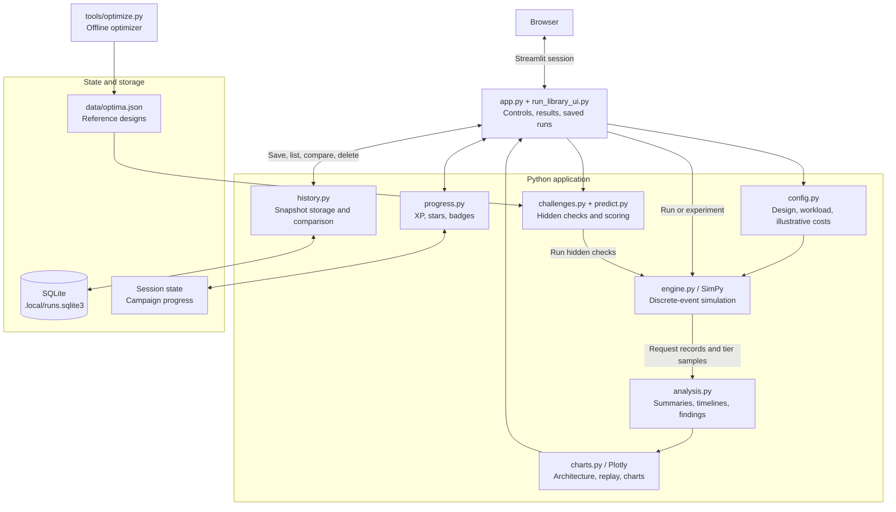
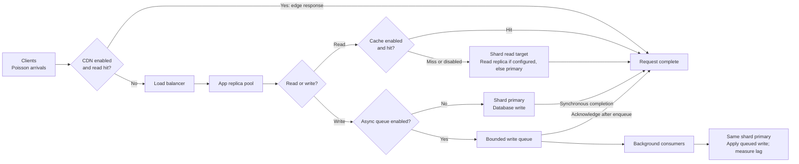

# System Design Simulator

[](https://github.com/ARB726/system-design-simulator/actions/workflows/ci.yml)

**Design a system, stress it, and see where it breaks.**

An interactive system-design learning lab built with Python, Streamlit, and SimPy. Explore how application replicas, caching, CDN hits, asynchronous writes, and database sharding affect throughput, latency, reliability, and cost.

Run experiments in a sandbox, solve budget-constrained challenges, and save competing designs to compare their measured tradeoffs. Findings come from simulation results and deterministic rules. The local demo needs no LLM or API key. An optional multi-user deployment adds OIDC sign-in, PostgreSQL libraries, Redis/Celery workers, and a C++ validation kernel.

## Features

| Feature | What you can do |
| --- | --- |
| Sandbox | Configure traffic, service times, capacity, queues, caches, replicas, and shards. |
| Chaos scenarios | Inject traffic spikes, replica crashes, cold caches, and database slowdowns. |
| Architecture and live replay | Inspect request paths, tier utilization, queues, and how bottlenecks move over time. |
| Saved runs and comparisons | Save named snapshots, compare results and configuration changes, restore designs, and download reports. |
| Challenge campaign | Solve six industry scenarios against hidden tests and monthly budgets. |
| Predict before running | Commit estimates for bottleneck, utilization, latency, and success, then score your predictions. |
| Experiments and validation | Sweep load and replica counts, compare load balancers, and check the simulator against queueing theory. |
| Learning progress | Earn stars, XP, levels, and badges; export progress and PNG share cards. |
| Themes | Choose among five accent themes, light/dark appearances, and industry filters. |

## Quick start

Use Python 3.10 or newer. Run the following commands from the repository root.

### Windows PowerShell

```powershell
python -m venv .venv
.\.venv\Scripts\Activate.ps1
python -m pip install -r requirements.txt
python -m streamlit run app.py
```

### macOS / Linux

```bash
python3 -m venv .venv
source .venv/bin/activate
python -m pip install -r requirements.txt
python -m streamlit run app.py
```

Open the local URL printed by Streamlit, normally `http://localhost:8501`.

The app runs simulations locally in the Python server process. It does not provision cloud infrastructure or send real traffic to external databases, caches, or CDNs.

## Application architecture

The UI orchestrates the simulation engine, analysis, challenges, and saved-run library. The engine and comparison logic are separate from the Streamlit presentation layer.



In local mode, simulations run synchronously and expensive results are cached with Streamlit. The multi-user deployment runs experiments in bounded Celery workers, uses Redis for transient jobs/results, and stores account-owned snapshots in PostgreSQL. See the [production architecture and runbook](docs/production.md) for the service diagram and deployment instructions.

## Simulated system architecture

This diagram represents the system **inside the simulator**, rather than the infrastructure hosting the app. CDN, cache, queue, and read replicas are optional.



The model tracks timeouts, dropped requests, replica errors, queue backlogs, and shard hot spots. An asynchronous write can be acknowledged before it reaches the database, so response latency and write-apply lag are reported separately.

## Save, compare, and explain

1. Choose **Sandbox**, configure a scenario, and run the simulation.
2. Under **Results**, expand **Save this run**, give it a name such as `Baseline`, and save it.
3. Change the architecture, press **Run simulation**, and save a candidate.
4. Open **Saved runs & compare** and select the baseline and candidate.

Comparisons show served throughput, success rate, p95/p99 latency, monthly cost, configuration differences, bottleneck changes, and measured tradeoffs. Warnings identify different workloads, chaos events, or seeds, and remind you that one stochastic run does not establish a reliable improvement.

Each snapshot preserves the completed run's configuration, summary, findings, and cost at save time. Pending sidebar edits are excluded until simulated. You can load a saved design back into the sandbox, download snapshots and comparison reports as JSON, or delete a selected run.

### Library access and persistence

The following describes local demo mode. In the [multi-user deployment](docs/production.md), libraries belong to signed-in OIDC identities and use shared PostgreSQL storage; URL parameters cannot select another account.

- **Bookmark the full URL**, including `?library=...`, to reopen your library after a browser or app restart.
- Anyone with that URL can read and edit the library. This is link-based access, not account authentication.
- Each library can hold up to **100 runs**.
- The default database is `.local/runs.sqlite3`, which is excluded from Git.
- Saved runs persist while the database file persists. Downloaded JSON reports preserve the results; the app does not currently import saved-run files.
- Challenge XP and badges use the separate **Save progress / Load progress** JSON controls.

To choose a persistent database location, set `SYSDESIGN_RUN_DB` before starting the app:

```powershell
# Windows PowerShell: use an existing persistent directory.
$env:SYSDESIGN_RUN_DB = 'C:\data\sysdesign\runs.sqlite3'
python -m streamlit run app.py
```

```bash
# macOS / Linux: use an existing persistent directory or mounted volume.
export SYSDESIGN_RUN_DB=/data/sysdesign/runs.sqlite3
python -m streamlit run app.py
```

The server process must be able to write to the directory. Ephemeral hosts can discard the database during redeployment. SQLite mode is designed for one app instance with durable storage. Use the PostgreSQL/worker deployment for shared multi-user storage.

## Challenge campaign

Earn a star on a challenge to unlock the next.

| Challenge | Industry | Main lesson |
| --- | --- | --- |
| Launch day: URL shortener | Social | Horizontal scaling, CDN/cache tradeoffs, and replica failures |
| Cache failure drill | E-commerce | Size the database for cache misses, not just the happy path |
| Write storm: chat service | Social | Async queues, write lag, and database capacity |
| Flash sale: checkout | E-commerce | Burst traffic, budgets, and database slowdowns |
| Payments ledger: the hot account | Fintech | Hot keys, sharding limits, and synchronous writes |
| Game launch: the leaderboard | Gaming | Reducing downstream load with a CDN |

Scores combine up to **70 points for reliability** and **30 for cost efficiency**. Cost-efficiency points require passing every hidden check. One star requires passing within budget; two and three stars require at least 80% and 97% efficiency against the stored reference cost.

Reference designs are computed offline and loaded from `data/optima.json`. To regenerate them:

```bash
python tools/optimize.py
```

The optimizer searches a finite configuration grid, screens candidates using estimated utilization, evaluates designs in cost order, and checks the winner on additional seeds. Its result is a reference within that search procedure, not a proof of the globally cheapest architecture.

## Modeling assumptions and limitations

- **Arrivals and service:** Poisson arrivals and exponential service times provide a queueing-theory baseline.
- **Tier behavior:** Workers are released before a request enters the next tier. Queue limits and client timeouts affect completion.
- **Failures and latency:** Timeout, drop, and error outcomes are included in effective latency using the configured timeout. Incomplete work is tracked separately.
- **Async writes:** Acknowledgement occurs after enqueue; apply lag measures when the database receives the write.
- **Simplifications:** Network transport latency, retries, replica lag, consistency semantics, and cache invalidation are not modeled.
- **Costs:** Prices are illustrative. Results support learning and relative comparisons rather than production capacity estimates.

Queueing behavior is checked against Erlang C / M/M/c formulas. The tests pool multiple seeds and check mean response time against theory; scenario tests cover failures, caching, queues, and sharding.

## Development and tests

```bash
python -m pip install -r requirements-dev.txt
python -m pytest -q
```

The suite covers the simulation engine, theoretical validation, challenges and scoring, progress import/export, run persistence and comparison, and Streamlit save/restore/delete flows. Simulation-heavy tests can take several minutes. CI also covers workload limits, authentication gates, job ownership, the C++ kernel, and disposable distributed services.

### Continuous integration

[GitHub Actions](https://github.com/ARB726/system-design-simulator/actions/workflows/ci.yml)
runs automatically on pushes and pull requests, and can be started manually from the Actions tab.
Core tests run on Python 3.10 and 3.12; Streamlit interaction tests run separately
on Python 3.12 using AppTest, without a browser or a running web server.

The workflow checks Python syntax, caches pip downloads, and uploads JUnit XML test reports
for seven days, including reports from failing test runs. New commits cancel outdated runs
for the same branch or pull request. CI uses disposable service data and read-only repository permissions; no production secrets are required. A dedicated job compiles C++, exercises PostgreSQL/Redis with a real worker, and builds and smoke-tests the Docker image.

Run the same test groups locally:

```bash
python -m pytest -m "not ui" -q
python -m pytest -m ui -q
```

## Project structure

| Path | Responsibility |
| --- | --- |
| `app.py` | Streamlit entry point, controls, tabs, and simulation orchestration |
| `sim/config.py` | Configuration dataclasses, presets, capacity estimates, and costs |
| `sim/engine.py` | SimPy engine, request routing, tiers, queues, shards, and chaos events |
| `sim/analysis.py` | Timelines, aggregate results, and rule-based findings |
| `sim/charts.py` | Plotly architecture diagrams, replay, and experiment charts |
| `sim/history.py` | SQLite/PostgreSQL snapshots and deterministic run comparisons |
| `sim/auth.py`, `sim/jobs.py`, `sim/worker.py` | OIDC ownership, bounded job admission, and Celery workers |
| `sim/execution.py`, `sim/job_ui.py` | JSON worker protocol and nonblocking UI polling |
| `sim/limits.py` | Server-side workload and allocation limits |
| `native/mmc.cpp`, `sim/native.py` | C++ validation kernel and Python adapter |
| `Dockerfile`, `compose.yml` | Web/worker images, health checks, and service deployment |
| `sim/run_library_ui.py` | Save, restore, delete, export, and comparison controls |
| `sim/challenges.py` | Challenge definitions, design knobs, hidden checks, and scoring |
| `sim/predict.py` | Prediction scoring |
| `sim/progress.py` | XP, badges, stars, levels, and progress import/export |
| `sim/experiments.py`, `sim/theory.py` | Parameter sweeps and queueing-theory validation |
| `sim/themes.py`, `.streamlit/config.toml` | Visual themes and industry labels |
| `sim/sharecard.py` | PNG share-card generation |
| `tools/optimize.py`, `data/optima.json` | Offline reference-design generation and stored results |
| `tests/` | Engine, application, persistence, and regression tests |

## Multi-user deployment and C++

See [docs/production.md](docs/production.md) for Docker Compose startup, OIDC configuration,
worker scaling, storage ownership, operating limits, backups, and rollout verification.

The optional C++17 M/M/c event kernel accelerates the Validation lab. The full topology
engine remains SimPy. Build and measure it with:

```bash
python tools/build_native.py
python tools/benchmark_native.py
```

The Docker image includes the compiled kernel. No native compiler is needed to run the
original Python-only demo.

## Future directions

Potential next steps include durable classroom progress, job cancellation and richer progress,
retry/backoff and rate-limiting scenarios, multi-region models, and classroom assignments.
Production load tests and operational monitoring should precede public rollout.
