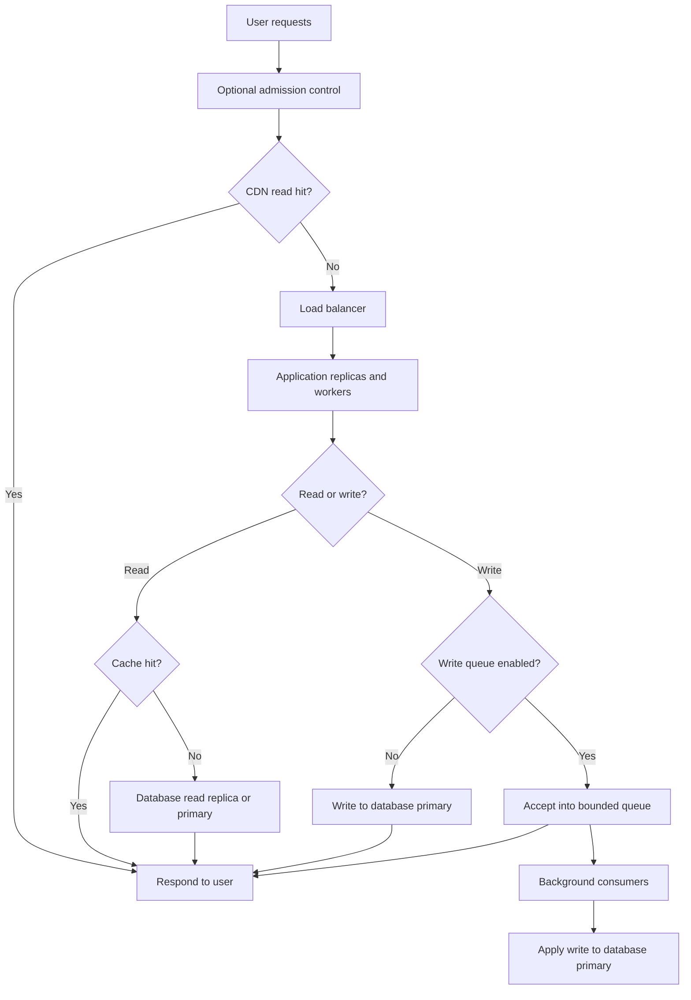

# System Design Simulator

**React full-stack edition:** [Local startup, features, and portable backups](fullstack/README.md) · [AWS deployment](fullstack/aws/DEPLOY.md). Run it locally without AWS or use the prepared serverless deployment.

**Live React application:** [Open Systems Lab](https://d11ry0yeilwlgs.cloudfront.net).

[](https://github.com/ARB726/system-design-simulator/actions/workflows/ci.yml)

**Design a system, stress it, and see where it breaks.**

An interactive learning lab for developers practicing system design. Build a simulated architecture, inject failures, and compare throughput, tail latency, reliability, and illustrative monthly cost before choosing a design.

**Stack:** Python, Streamlit, SimPy, Plotly, SQLite. Optional multi-user deployment: PostgreSQL, Redis, Celery, OIDC, and a C++17 validation kernel.

[Try it locally](#quick-start) · [Two-minute walkthrough](#two-minute-walkthrough) · [Engineering case study](docs/performance.md) · [Architecture](docs/architecture.md)

## Engineering highlights

- **Model system behavior:** a discrete-event engine models replicas, caches, CDN hits, sharding, bounded queues, timeouts, and failures. Response latency and asynchronous write-apply lag are measured separately.
- **Optimize without changing results:** the summary execution path reduced peak traced Python allocations by **84.1%** (3.366 to 0.535 MiB) in the [recorded local benchmark](docs/benchmarks/summary-local.md). The workload offered 500 requests/s for 20 simulated seconds; metric-equivalence checks passed at 1e-12 tolerance. This measures Python allocations for one workload, not process memory or production capacity. Median runtime changed from 1.9193 to 1.8622 seconds.
- **Make comparisons explainable:** saved snapshots preserve completed configurations and results; comparisons flag changes in workloads, seeds, and chaos events that could confound conclusions.
- **Separate the engine from delivery:** the same simulation core supports a local demo and an optional authenticated deployment with bounded background jobs and account-owned storage. See the [deployment design](docs/production.md).
- **Validate the model:** queueing-theory checks, regression tests, Streamlit interaction tests, and distributed-service CI cover the engine and its delivery paths. See [test coverage](docs/testing-coverage.md) and the [development guide](docs/development.md).

## How it works

Think of the simulator as a virtual lab: configure an imaginary service, send requests through it, and watch where work starts waiting. A request is one action, such as opening a short link (a read) or saving a chat message (a write).

There are two architectures to keep separate: **the service being simulated** and **the application running the experiment**. The CDN, cache, and database you configure are simulated resources; running an experiment does not create those services in the cloud.

### The service you design



A **replica** is another copy of a server; a **worker** is a slot that can process one request at a time. The load balancer chooses an application replica. Reads can use a cached answer or continue to the database. Writes either wait for the database or receive an acknowledgement after entering the optional queue. Database **shards** divide traffic among separate database groups.

Each choice moves work or changes when it happens:

| Choice | Why use it? | What is the tradeoff? |
| --- | --- | --- |
| More application replicas or workers | Process more requests at once | Higher illustrative cost; an overloaded database can still limit the system |
| CDN | Answer some reads before they reach the application | Additional cost; the model assumes a configured hit rate |
| Cache | Answer repeated reads without database work | Additional cost; a cold cache suddenly sends more work to the database |
| Read replicas | Move reads away from the database primary | Additional cost; writes still go to the primary |
| Shards | Spread reads and writes across database groups | Additional cost; uneven traffic can leave one shard overloaded |
| Write queue | Absorb a temporary burst and acknowledge writes sooner | The write is applied later; sustained overload grows the backlog until the queue fills |
| Read retries with backoff and jitter | Try again after a temporary failure, with spaced and randomized delays | More attempts and longer waits; retries can worsen overload |
| Admission control | Limit attempts entering the system to protect downstream resources | Some attempts are rejected, so smaller queues do not necessarily mean better user success |

For example, when a cache goes cold, more reads reach the database. Its queue can grow, responses slow down, and clients may time out. Adding application servers will not necessarily help that database constraint. The experiment is to identify the pressure, change one thing, and compare success, latency, backlog, and cost. Real cache freshness, replication delay, and cross-shard coordination add further tradeoffs outside this model; see [modeling limitations](#modeling-assumptions-and-limitations).

### The application running the experiment

1. **Configure:** Streamlit controls build a `Config` containing the design, workload, random seed, and failure schedule.
2. **Simulate:** the SimPy engine advances simulated time from event to event: requests arrive, wait for workers, finish, or time out. A simulated minute does not require a real minute. No external service receives this traffic.
3. **Analyze:** request outcomes and sampled resource activity become throughput, success rate, latency percentiles, queue timelines, and bottleneck findings. A p95 latency is a value at or below which about 95% of measured latencies fall.
4. **Explore:** Plotly charts show when pressure develops. Async write acknowledgement latency and write-apply lag are separate, so a quick response does not hide unfinished work.
5. **Compare:** save configuration/result snapshots and test a candidate under the same workload and failures. Repeating both designs across seeds helps reveal variation within the model; it does not establish production accuracy.

The engine and analysis are separate from the interface, so experiments, challenge checks, and background workers reuse the same core. For the component diagram and source boundaries, see [Architecture](docs/architecture.md).

## Why these technologies?

| Technology | Role and reason for the choice | Tradeoff or boundary |
| --- | --- | --- |
| Python | Keeps the simulation, analysis, and experiment logic together in an accessible language | CPU-heavy experiments need bounded workloads and execution resources |
| SimPy | Represents queues, limited workers, and timed events without provisioning infrastructure | Results depend on simplified arrival, service, and resource models |
| Streamlit | Connects Python controls, results, and learning exercises in one interactive app | Reruns and browser session state need care; long jobs benefit from background execution |
| pandas and Plotly | Turn recorded events into tables and interactive charts | Detailed traces and charts consume memory; summary-only experiment paths retain less detail |
| SQLite | Stores local saved runs in a file, with no database service to operate | The optional account-based deployment uses PostgreSQL for shared storage |
| PostgreSQL, Redis, and Celery (optional) | Store account-owned snapshots, queue jobs, and run simulations in background processes that can scale separately from the UI | More services to operate; Redis job results expire, while saved PostgreSQL snapshots persist |
| OIDC (optional) | Uses an identity provider for sign-in and account-scoped access | Requires provider configuration and deployment setup |
| C++17 (optional) | Provides a standalone event kernel for the narrower mathematical queueing validation lab | Does not implement the full CDN/cache/sharding/failure simulation |

**Local mode** keeps setup small: Streamlit runs simulations synchronously in the Python server process and SQLite stores saved runs. The **optional multi-user deployment** moves execution into bounded Celery workers and uses shared storage. Its real job queue schedules experiments; it is separate from the imaginary write queue inside a simulated design. See the [production runbook](docs/production.md) for deployment requirements and operating limits.

## Two-minute walkthrough

For an in-app introduction, choose **Start guided walkthrough**. It walks through a cold-cache failure, one capacity change, and a paired comparison across seeds. See the [learning and resilience guide](docs/learning-lab.md) for evidence windows, retry/backoff policies, admission control, and bounded parallel sweeps.

After starting the app locally:

1. In **Sandbox**, choose **Failure: cache goes cold** from **Scenario**, then press **Run simulation**. If prediction mode is enabled, use **Lock prediction and run** to start the run.
2. Inspect the results and replay: follow database pressure and latency as the cache loses effectiveness. Expand **Save this run** and save it as `Baseline`.
3. Increase **Connections per node** under **Database** in the sidebar, keeping the workload, seed, and failure scenario unchanged. Run again and save as `More DB capacity`.
4. Open **Saved runs & compare**. Compare success rate, p95/p99 latency, and monthly cost. Explain whether the extra capacity was worth its cost for this scenario.

For another tradeoff, open **Find your next experiment** and try **Can a queue absorb a burst?** Compare acknowledgement latency with write-apply lag. Selecting a guided experiment replaces the current sandbox settings.

The demo runs locally without an LLM, API key, or cloud account. See the [user guide](docs/user-guide.md) for saved-library access, persistence, and the six-challenge campaign.

## Quick start

Use Python 3.10 or newer. Run the following commands from the repository root.

### Windows PowerShell

```powershell
python -m venv .venv
.\.venv\Scripts\Activate.ps1
python -m pip install -r requirements.txt
python -m streamlit run app.py
```

### macOS / Linux

```bash
python3 -m venv .venv
source .venv/bin/activate
python -m pip install -r requirements.txt
python -m streamlit run app.py
```

Open the local URL printed by Streamlit, normally `http://localhost:8501`.

The app runs simulations locally in the Python server process. It does not provision cloud infrastructure or send real traffic to external databases, caches, or CDNs.

## Modeling assumptions and limitations

- **Arrivals and service:** Poisson arrivals and exponential service times provide a queueing-theory baseline.
- **Tier behavior:** Workers are released before a request enters the next tier. Queue limits and client timeouts affect completion.
- **Failures and latency:** Timeout, drop, and error outcomes are included in effective latency using the configured timeout. Incomplete work is tracked separately.
- **Async writes:** Acknowledgement occurs after enqueue; apply lag measures when the database receives the write.
- **Retries and admission:** Optional read retries use bounded exponential backoff and jitter; a token bucket can reject excess attempts. Writes are never retried. Attempt amplification and user-visible success are reported separately.
- **Simplifications:** Network transport latency, replica lag, consistency semantics, write idempotency, and cache invalidation are not modeled.
- **Costs:** Prices are illustrative. Results support learning and relative comparisons rather than production capacity estimates.

Queueing behavior is checked against Erlang C / M/M/c formulas. The tests pool multiple seeds and check mean response time against theory; scenario tests cover failures, caching, queues, and sharding.

## Explore the project

| Read | What it explains |
| --- | --- |
| [Architecture](docs/architecture.md) | Application components, request routing, and storage boundaries |
| [Performance case study](docs/performance.md) | Optimization decisions, benchmark methodology, and correctness checks |
| [User guide](docs/user-guide.md) | Saved runs, comparisons, persistence, and challenge scoring |
| [Learning and resilience](docs/learning-lab.md) | Guided experiments, measured evidence, paired seeds, retry storms, and admission control |
| [Development guide](docs/development.md) | Test commands, CI, source map, and native kernel build |
| [Production runbook](docs/production.md) | Optional multi-user deployment, ownership, worker limits, and operations |

## Future directions

Potential next steps include durable classroom progress, job cancellation and richer progress,
multi-region models, and classroom assignments.
Production load tests and operational monitoring should precede public rollout.
