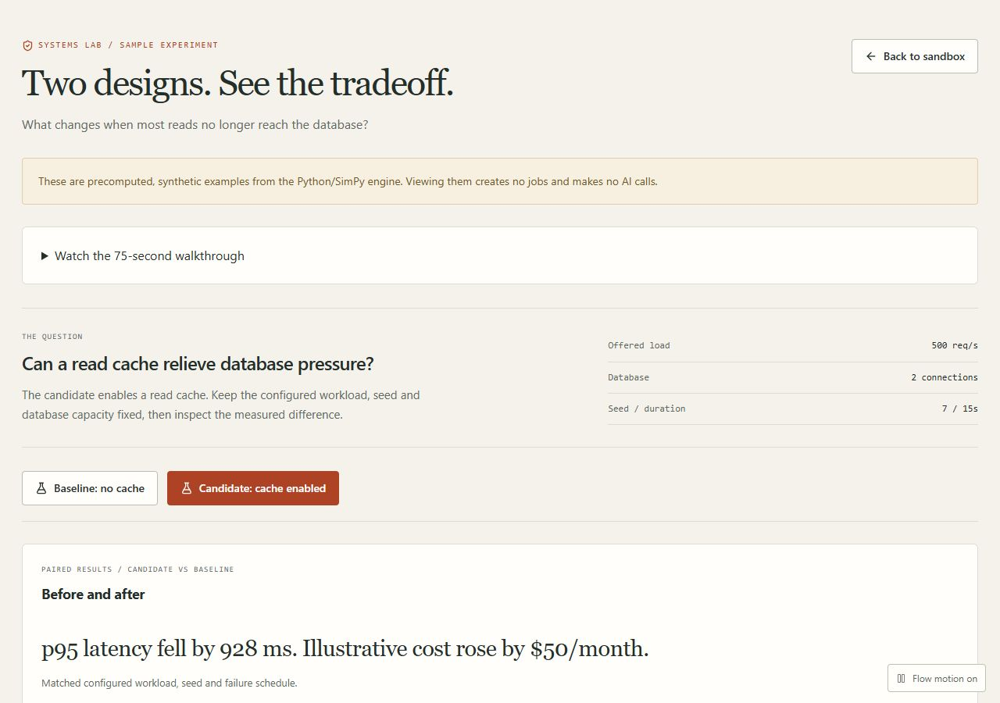
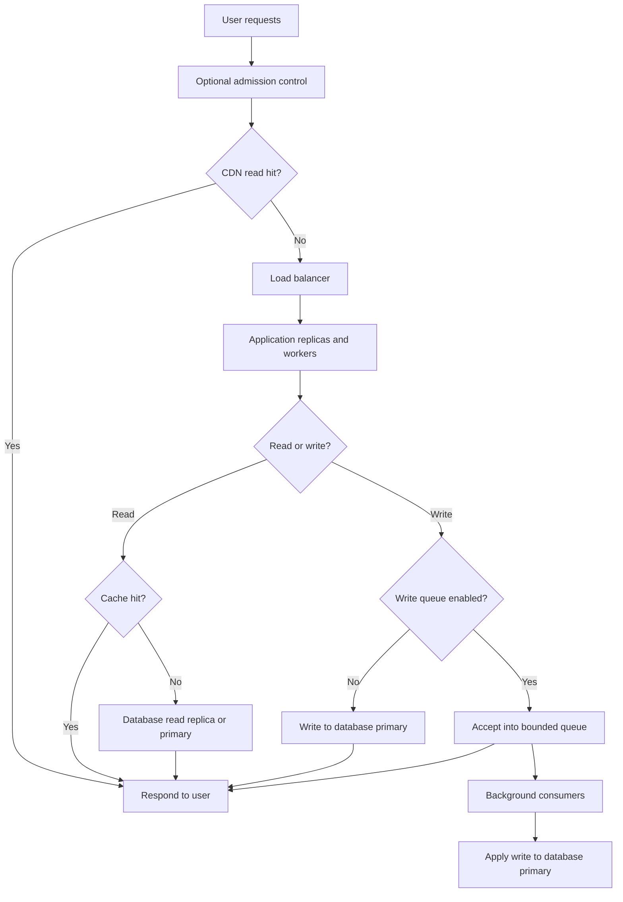

# Systems Lab - System Design Simulator

[](https://github.com/ARB726/system-design-simulator/actions/workflows/ci.yml)

I built Systems Lab because I wanted to test system design ideas instead of stopping at diagrams. I can configure an architecture, put it under load, introduce failures, and see where requests start waiting. Then I can change one part of the design and compare the results.

I started with a Python simulation engine and a Streamlit interface. I later added a Next.js frontend, Google sign-in, saved experiments, background workers, and a Gemini architecture coach. Both interfaces use the same Python/SimPy engine.

## Live app

**[Open Systems Lab](https://d11ry0yeilwlgs.cloudfront.net/)** · **[Try the guest demo](https://d11ry0yeilwlgs.cloudfront.net/#demo)**

The guest demo is the quickest way to see the project. Click **Try without signing in** to compare two recorded experiments, inspect their architecture, and see the measured tradeoff. It does not require an account or make an AI call.

[](https://d11ry0yeilwlgs.cloudfront.net/#demo)

### What I added to the interface

I redesigned the frontend around the way I run an experiment: configure the system, inspect the evidence, and compare a change. I replaced the separate architecture illustrations with one interactive schematic and made the controls and results easier to read.

- **Interactive architecture:** click a tier to inspect its configured capacity, or toggle the cache, CDN, and write queue to change the model.
- **Before-and-after results:** compare throughput, p95 latency, success rate, and illustrative monthly cost. The outcome summary explains the latency/cost tradeoff and flags different test conditions.
- **Bottleneck evidence:** inspect utilization and queue pressure before deciding what to change. I treat the busiest tier as a starting point for another experiment, not proof of a production limit.
- **Read-only sharing:** create a link containing an experiment's configuration and results. It leaves out login tokens, owner identifiers, and AI conversations. Shared values are labelled unverified, and links cannot be revoked.
- **Short walkthrough:** watch a captioned 75-second example showing database overload, a cached candidate, and the comparison. I included a transcript, pause controls, and reduced-motion support.

The guest example uses 120 offered requests/s. The video uses a separate 500 requests/s experiment so the overload is visible. Both use recorded synthetic engine output. The [walkthrough guide](docs/walkthrough.md) explains how I generated the examples, and the [design notes](docs/design-system.md) explain the interface decisions.

### Run an experiment

1. Sign in through **Continue with Google** to use a private workspace. While the Google OAuth app is in testing, sign-in is limited to its configured test users; the guest demo remains available without signing in.
2. Configure the workload, capacity, and failure conditions, then click **Run simulation**. Background workers execute the experiment and save the result.
3. Inspect the charts and bottleneck takeaway. Keep the configured workload, random seed, and failure schedule fixed when testing an architecture change.
4. Select two completed runs in **Experiment library**, then open **Compare designs**.
5. Use **Explain my results** for a Gemini explanation grounded in the saved measurements. I use it to suggest a next experiment, not to validate production capacity.

### Hosted architecture

| Layer | What I use | What it does |
| --- | --- | --- |
| Frontend | Next.js, React, TypeScript, Recharts | Interactive workbench, architecture schematic, and result charts |
| Frontend hosting | AWS S3 + CloudFront | Stores and serves the exported website |
| API | Python, FastAPI, AWS API Gateway + Lambda | Handles authenticated experiments and AI requests |
| Simulation | SimPy | Models requests, worker capacity, queues, and failure scenarios |
| Background jobs | AWS SQS + Lambda workers | Queues and executes simulation jobs |
| Saved experiments | AWS DynamoDB + S3 | Stores experiment metadata and result snapshots |
| Sign-in | Supabase Auth + Google | Signs users in; the API verifies their tokens |
| Shared AI controls | Supabase PostgreSQL | Tracks usage limits, concurrent request leases, and cached answers |
| AI explanations | Google Gemini | Explains a user's completed simulation using saved evidence |

I keep the Gemini key on the backend, so visitors do not need their own API key. AI access is bounded to five attempts per user and twenty globally per UTC hour, with two requests allowed at once. I also added an owner-scoped one-hour answer cache. Cached answers do not consume another attempt; failed attempts do.

For the local Python lab, I use **Streamlit, pandas, Plotly, and SQLite**. There is also an optional **PostgreSQL/Redis/Celery** deployment and a **C++17** kernel for the narrower queueing-validation lab. The hosted app uses the AWS job path shown above.

[Local setup](#quick-start) · [Architecture](docs/architecture.md) · [Google sign-in and AI setup](fullstack/PUBLIC_ACCESS.md) · [Local walkthrough](#two-minute-walkthrough)

## Engineering results

- **Memory:** I reduced peak traced Python allocations by **84.1%**, from **3.366 to 0.535 MiB**, by adding a summary execution path that does not retain unnecessary request detail. I checked metric equivalence at **1e-12** relative/absolute tolerance. [Benchmark and methodology](docs/benchmarks/summary-local.md).
- **Runtime:** I recorded about **3.0% lower median local runtime**, from **1.9193 to 1.8622 seconds**, across three timing repetitions per path. The workload was 500 offered requests/s over 20 simulated seconds, with a one-second warmup and seed 7. [Raw samples](docs/benchmarks/summary-local.json).
- **Browser workflow:** I verified the redesigned app with **28 passing Playwright tests**, covering configuration, comparisons, Google session recovery, guest access, read-only sharing, video playback, and responsive layout. I also checked the deployed interface at 320px and 390px widths. [Browser tests](fullstack/frontend/tests/).
- **Google sign-in:** I covered PKCE initiation, callback exchange, sign-out, missing-verifier recovery, and an already-consumed callback with an existing session in **five passing authentication tests**. [Authentication tests](fullstack/frontend/tests/google-auth.spec.ts).
- **AI usage:** I bounded shared AI access with atomic PostgreSQL counters, request leases, and an owner-scoped answer cache. These are configured limits, not measured traffic or cost savings. [AI access design](fullstack/PUBLIC_ACCESS.md).

### Recorded metrics

| Metric | Baseline | Result | Evidence |
| --- | ---: | ---: | --- |
| Peak traced Python allocations | 3.366 MiB | 0.535 MiB (**84.1% lower**) | Local summary benchmark |
| Median execution time | 1.9193 s | 1.8622 s (**about 3.0% lower**) | Three timing repetitions per path |
| Metric equivalence tolerance | Full execution reference | **1e-12** relative/absolute | Benchmark checks |
| Web workflow regression run | - | **28 passed** | Playwright regression run |
| Google authentication browser tests | - | **5 passed** | Authentication regression run |
| AI usage limits | - | **5/user/hour; 20 globally/hour; 2 concurrent** | Backend admission policy |

The memory and runtime figures describe one local workload. I measured Python allocations with `tracemalloc`, not process RSS. Three timing repetitions do not establish a production speedup. I have not measured production user capacity or cost savings, and simulated request rates are not real API throughput.

## How it works

I use the simulator as a virtual lab: configure a service, generate simulated requests, and watch where work starts waiting. A request is one action, such as opening a short link (a read) or saving a chat message (a write).

There are two architectures to keep separate: **the service being simulated** and **the application running the experiment**. The CDN, cache, and database you configure are simulated resources; running an experiment does not create those services in the cloud.

### The service you design



A **replica** is another copy of a server; a **worker** is a slot that can process one request at a time. The load balancer chooses an application replica. Reads can use a cached answer or continue to the database. Writes either wait for the database or receive an acknowledgement after entering the optional queue. Database **shards** divide traffic among separate database groups.

Each choice moves work or changes when it happens:

| Choice | Why use it? | What is the tradeoff? |
| --- | --- | --- |
| More application replicas or workers | Process more requests at once | Higher illustrative cost; an overloaded database can still limit the system |
| CDN | Answer some reads before they reach the application | Additional cost; the model assumes a configured hit rate |
| Cache | Answer repeated reads without database work | Additional cost; a cold cache suddenly sends more work to the database |
| Read replicas | Move reads away from the database primary | Additional cost; writes still go to the primary |
| Shards | Spread reads and writes across database groups | Additional cost; uneven traffic can leave one shard overloaded |
| Write queue | Absorb a temporary burst and acknowledge writes sooner | The write is applied later; sustained overload grows the backlog until the queue fills |
| Read retries with backoff and jitter | Try again after a temporary failure, with spaced and randomized delays | More attempts and longer waits; retries can worsen overload |
| Admission control | Limit attempts entering the system to protect downstream resources | Some attempts are rejected, so smaller queues do not necessarily mean better user success |

For example, when a cache goes cold, more reads reach the database. Its queue can grow, responses slow down, and clients may time out. Adding application servers will not necessarily help that database constraint. The experiment is to identify the pressure, change one thing, and compare success, latency, backlog, and cost. Real cache freshness, replication delay, and cross-shard coordination add further tradeoffs outside this model; see [modeling limitations](#modeling-assumptions-and-limitations).

### The application running the experiment

1. **Configure:** I build a `Config` from the web workbench or local Streamlit controls. It contains the design, workload, random seed, and failure schedule.
2. **Simulate:** I run that configuration through SimPy. The engine advances from event to event as requests arrive, wait for workers, finish, or time out. No external service receives this simulated traffic.
3. **Analyze:** I turn the recorded outcomes into throughput, success rate, latency percentiles, queue timelines, and bottleneck findings.
4. **Inspect:** I show the evidence through Recharts in the web app and Plotly in the local lab. I keep asynchronous write acknowledgement separate from write-apply lag, so a quick response does not hide unfinished work.
5. **Compare:** I save the configuration and result, change one variable, and compare under the same configured workload, seed, and failures. Repeating across seeds helps show variation within the model.

I kept the engine and analysis separate from the interface so experiments, challenge checks, and background workers reuse the same core. For the component diagram and source boundaries, see [Architecture](docs/architecture.md).

## Why these technologies?

| Technology | Why I use it | Tradeoff or boundary |
| --- | --- | --- |
| Python | Keeps the simulation, analysis, and experiment logic together in an accessible language | CPU-heavy experiments need bounded workloads and execution resources |
| SimPy | Represents queues, limited workers, and timed events without provisioning infrastructure | Results depend on simplified arrival, service, and resource models |
| Streamlit | Connects Python controls, results, and learning exercises in one interactive app | Reruns and browser session state need care; long jobs benefit from background execution |
| pandas and Plotly | Turn recorded events into tables and interactive charts | Detailed traces and charts consume memory; summary-only experiment paths retain less detail |
| SQLite | Stores local saved runs in a file, with no database service to operate | The optional account-based deployment uses PostgreSQL for shared storage |
| PostgreSQL, Redis, and Celery (optional) | Store account-owned snapshots, queue jobs, and run simulations in background processes that can scale separately from the UI | More services to operate; Redis job results expire, while saved PostgreSQL snapshots persist |
| OIDC (optional) | Uses an identity provider for sign-in and account-scoped access | Requires provider configuration and deployment setup |
| C++17 (optional) | Provides a standalone event kernel for the narrower mathematical queueing validation lab | Does not implement the full CDN/cache/sharding/failure simulation |

**Local mode** keeps setup small: Streamlit runs simulations synchronously in the Python server process and SQLite stores saved runs. The **optional multi-user deployment** moves execution into bounded Celery workers and uses shared storage. Its real job queue schedules experiments; it is separate from the imaginary write queue inside a simulated design. See the [production runbook](docs/production.md) for deployment requirements and operating limits.

## Two-minute walkthrough

In the local Streamlit app, choose **Start guided walkthrough** for an in-app introduction. The hosted app has the separate 75-second video described above. It walks through a cold-cache failure, one capacity change, and a paired comparison across seeds. See the [learning and resilience guide](docs/learning-lab.md) for evidence windows, retry/backoff policies, admission control, and bounded parallel sweeps.

After starting the app locally:

1. In **Sandbox**, choose **Failure: cache goes cold** from **Scenario**, then press **Run simulation**. If prediction mode is enabled, use **Lock prediction and run** to start the run.
2. Inspect the results and replay: follow database pressure and latency as the cache loses effectiveness. Expand **Save this run** and save it as `Baseline`.
3. Increase **Connections per node** under **Database** in the sidebar, keeping the workload, seed, and failure scenario unchanged. Run again and save as `More DB capacity`.
4. Open **Saved runs & compare**. Compare success rate, p95/p99 latency, and monthly cost. Explain whether the extra capacity was worth its cost for this scenario.

For another tradeoff, open **Find your next experiment** and try **Can a queue absorb a burst?** Compare acknowledgement latency with write-apply lag. Selecting a guided experiment replaces the current sandbox settings.

The Streamlit demo runs locally without an LLM, API key, or cloud account. The hosted app adds Google sign-in and optional Gemini explanations. See the [user guide](docs/user-guide.md) for the local lab's saved-library access, persistence, and six-challenge campaign.

## Quick start

Use Python 3.10 or newer. Run the following commands from the repository root.

### Windows PowerShell

```powershell
python -m venv .venv
.\.venv\Scripts\Activate.ps1
python -m pip install -r requirements.txt
python -m streamlit run app.py
```

### macOS / Linux

```bash
python3 -m venv .venv
source .venv/bin/activate
python -m pip install -r requirements.txt
python -m streamlit run app.py
```

Open the local URL printed by Streamlit, normally `http://localhost:8501`.

The app runs simulations locally in the Python server process. It does not provision cloud infrastructure or send real traffic to external databases, caches, or CDNs.

## Modeling assumptions and limitations

- **Arrivals and service:** Poisson arrivals and exponential service times provide a queueing-theory baseline.
- **Tier behavior:** Workers are released before a request enters the next tier. Queue limits and client timeouts affect completion.
- **Failures and latency:** Timeout, drop, and error outcomes are included in effective latency using the configured timeout. Incomplete work is tracked separately.
- **Async writes:** Acknowledgement occurs after enqueue; apply lag measures when the database receives the write.
- **Retries and admission:** Optional read retries use bounded exponential backoff and jitter; a token bucket can reject excess attempts. Writes are never retried. Attempt amplification and user-visible success are reported separately.
- **Simplifications:** Network transport latency, replica lag, consistency semantics, write idempotency, and cache invalidation are not modeled.
- **Costs:** Prices are illustrative. Results support learning and relative comparisons rather than production capacity estimates.

Queueing behavior is checked against Erlang C / M/M/c formulas. The tests pool multiple seeds and check mean response time against theory; scenario tests cover failures, caching, queues, and sharding.

## Explore the project

| Read | What it explains |
| --- | --- |
| [Architecture](docs/architecture.md) | Application components, request routing, and storage boundaries |
| [Performance case study](docs/performance.md) | Optimization decisions, benchmark methodology, and correctness checks |
| [User guide](docs/user-guide.md) | Saved runs, comparisons, persistence, and challenge scoring |
| [Learning and resilience](docs/learning-lab.md) | Guided experiments, measured evidence, paired seeds, retry storms, and admission control |
| [Development guide](docs/development.md) | Test commands, CI, source map, and native kernel build |
| [Production runbook](docs/production.md) | Optional multi-user deployment, ownership, worker limits, and operations |

## What I want to improve next

I want to add job cancellation, clearer progress reporting, durable classroom progress, and more guided assignments. I also want to complete production load testing and improve operational monitoring before opening access beyond the configured OAuth test users.
