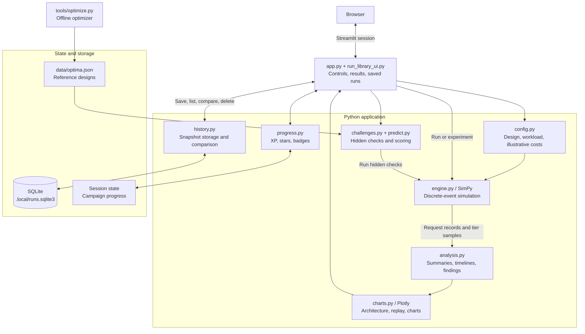
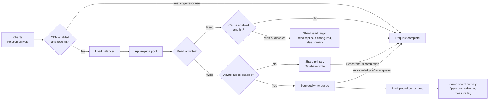

# Architecture

## Application architecture

The UI orchestrates the simulation engine, analysis, challenges, and saved-run library. The engine and comparison logic are separate from the Streamlit presentation layer.

In local mode, simulations run synchronously and expensive results are cached with Streamlit. The multi-user deployment runs experiments in bounded Celery workers, uses Redis for transient jobs/results, and stores account-owned snapshots in PostgreSQL. See the [production architecture and runbook](production.md) for the service diagram and deployment instructions.

## Simulated system architecture

This diagram represents the system **inside the simulator**, rather than the infrastructure hosting the app. CDN, cache, queue, and read replicas are optional.

The model tracks timeouts, dropped requests, replica errors, queue backlogs, and shard hot spots. An asynchronous write can be acknowledged before it reaches the database, so response latency and write-apply lag are reported separately.
