# Durable experiment execution under failure

Systems Lab runs experiments as durable jobs. This case study examines a concrete
correctness defect found during code review and the failure schedules used to fix
it. It is not a report of a production outage.

## The defect and the invariant

Previously, a worker could finish after its lease expired. The cloud completion
path reread the current job and used that newer snapshot as its compare-and-swap
condition, without proving that the caller still owned the attempt. Both workers
also uploaded to the same S3 key. A late upload could replace the winner's bytes
even when the metadata transaction rejected the late completion. The local store
updated completion by job ID and owner, with no attempt check.

The invariant is: **only the current, unexpired attempt may publish a result;
once a job is terminal, later attempts cannot change its published result.**

Execution can repeat. This protocol provides fenced publication, not exactly-once
computation or exactly-once arbitrary side effects.

## State machine

```mermaid
stateDiagram-v2
    [*] --> queued
    queued --> running: atomic claim; new token
    running --> running: expired lease; replacement token
    running --> completed: current token; unexpired lease
    running --> failed: execution error or exhausted attempts
    queued --> failed: enqueue failure or dead-letter cleanup
    completed --> [*]
    failed --> [*]
```



- The lease lasts 330 seconds, matching the previous cloud worker expiry policy.
  There is no heartbeat; experiments must finish within this bound to publish.
- A claim receives a random attempt token and increments the persisted attempt
  count. An expired job can be reclaimed up to three total attempts. A simulation
  exception is immediately terminal; worker interruption or persistence failure
  leaves the lease available for recovery.
- SQLite serializes claims using a write transaction. PostgreSQL uses
  `FOR UPDATE SKIP LOCKED`. SQL completion checks owner, running state, token,
  and expiry in one conditional update. SQL quota counts active rows.
- DynamoDB claims compare the entire observed job document. Completion first
  checks the caller's token, then conditionally commits the observed document
  and releases the owner's active-job slot in one transaction. A fresh timestamp
  after upload is included in the expiry condition. SDK retries reuse the
  transaction's request token.
- Every cloud publication uploads to a unique S3 object key. Only a successful
  metadata transaction makes that object discoverable through the job. A losing
  upload cannot modify the winner's object.
- A duplicate delivery for a terminal job is acknowledged without execution.
  Live-lease duplicates and persistence errors request record-level redelivery.
  Dead-letter processing cannot terminate a live attempt.

## Reproduce the process-death schedule

From the repository root, after installing
`fullstack/backend/requirements-test.txt`:

```powershell
python tools/job_recovery_lab.py recovery
python -m pytest tests/test_job_leases.py tests/test_job_aws.py tests/test_job_delivery.py -q
```

The recovery lab creates a temporary SQLite database and starts a separate Python
process. That process claims a job and exits with code 23 without publishing or
running cleanup. The parent verifies that the live lease blocks another claim,
advances the application clock to the expiry boundary, and reclaims the job.
Publication by the old attempt is rejected before and after the replacement
commits. The final saved result belongs to the replacement. Advancing the clock
keeps the demo short; the child process death is real.

The recorded [recovery output](benchmarks/job-recovery.json) captures the assertions.
The tests also cover eight concurrent local claimers, existing SQL schema upgrades,
quota exhaustion and release, malformed messages, record-level read failures,
death before publication, and redelivery after completion.

Moto tests exercise DynamoDB conditional expressions, transactions, quota updates,
and S3 writes in an in-process service emulator. The key race deliberately pauses
an old attempt inside its upload, expires its lease, lets a replacement publish,
then resumes the old upload and transaction. The old transaction fails and the
replacement's result remains intact. These tests do not establish live AWS behavior.

## Measure the real local pipeline

```powershell
python tools/job_recovery_lab.py benchmark --jobs 20 --workers 1 --output .local/jobs-1.json
python tools/job_recovery_lab.py benchmark --jobs 20 --workers 2 --output .local/jobs-2.json
```

The benchmark commits 20 jobs, then consumes them through the real SQL claim,
Python simulation, serialization, and completion paths. An import/execution
warmup precedes measurement. Each job simulates 30 offered requests/s over ten
simulated seconds, with a one-second warmup and seed 42. Those 30 requests/s
describe the model, not traffic sent to a backend.

Raw artifacts include the configuration, environment, each job's queue wait,
service time and completion time, wall time, process CPU time, and throughput.
Completion latency starts at each submission's return; throughput measures the
consumer phase. Initial queued depth is 20, across ten owners, respecting the
two-active-job admission limit. Workers are threads in one Python process.
The benchmark bypasses HTTP, authentication, SQS, and cloud storage.

| Local sample | Completed jobs/s | p95 completion | Process CPU time |
| --- | ---: | ---: | ---: |
| [One worker](benchmarks/job-pipeline-1-worker.json) | 10.58 | 1.80 s | 1.70 s |
| [Two workers](benchmarks/job-pipeline-2-workers.json) | 12.44 | 1.61 s | 1.73 s |

These are single local samples of 20 small jobs, not a production capacity claim
or a reliable scaling comparison. Thread contention, the GIL, SQLite writes,
machine load, and workload size can affect results. CPU time is measured for the
whole process; memory and production cost are not measured here. Repeat with
larger workloads and independent trials before making performance claims.

## Operational limits and rollout

Drain old workers before deploying this protocol: an old binary does not enforce
the new token checks or immutable-result convention. Existing running cloud jobs
without tokens can be reclaimed after the legacy expiry boundary. SQL schema
columns are added automatically under a migration lock; back up persistent data
before rollout and manage larger migrations separately.

The code does not deploy queue settings. Both main-queue and dead-letter event
source mappings must enable `ReportBatchItemFailures` to honor partial responses.
Match the function runtime and queue visibility/retry policy to the fixed lease.
AWS documents these requirements in its
[SQS error-handling guide](https://docs.aws.amazon.com/lambda/latest/dg/services-sqs-errorhandling.html).
Atomic quota release relies on DynamoDB's
[transaction semantics](https://docs.aws.amazon.com/amazondynamodb/latest/APIReference/API_TransactWriteItems.html).

Leases use application wall clocks, so clock synchronization matters. The cloud
expiry timestamp is sampled before the transaction request; it is not a DynamoDB
server clock. Token comparison fences a replacement even if clocks differ.

The database-write/message-send boundary still lacks a transactional outbox:
process death between job creation and enqueue can strand a queued job. Queue
retention, dead-letter delivery, and operational reconciliation remain necessary.
Losing uploads can leave unreferenced S3 objects; this change does not delete them
or configure lifecycle rules. Malformed messages remain retryable and need a
bounded redrive/quarantine policy. Restoring service availability after an outage
depends on the polling worker or queue redelivery actually running.
